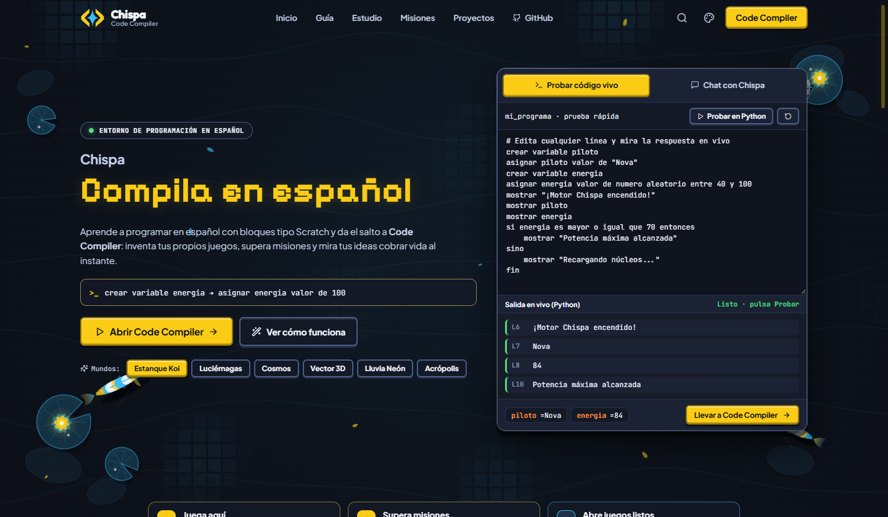
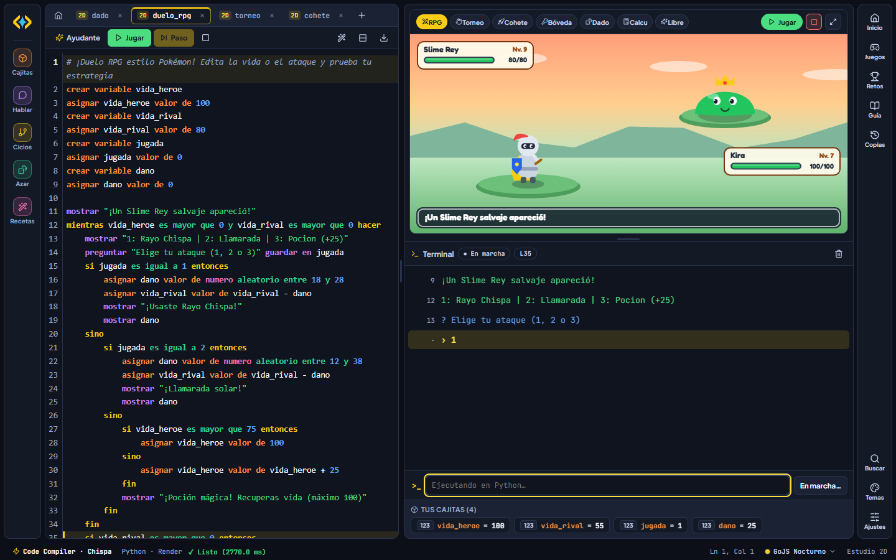
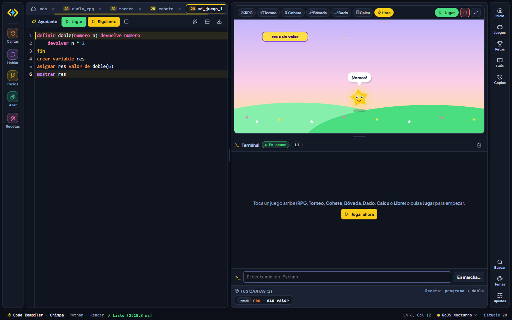
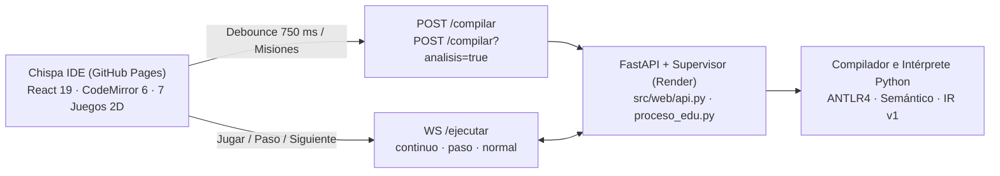

<div align="center">

<br>

<picture>
  <source media="(prefers-color-scheme: dark)" srcset="./docs/chispa-logo-dark.svg">
  <source media="(prefers-color-scheme: light)" srcset="./docs/chispa-logo-light.svg">
  
</picture>

<h3>De bloques tipo Scratch a <em>código real en español</em>.</h3>

<p>
  <strong>Compilador, intérprete de código intermedio en Python + ANTLR4 y estudio web interactivo 2D</strong><br>
  para aprender a programar en español con el lenguaje <code>.edu</code>, depuración paso a paso en vivo y misiones guiadas.
</p>

<p>
  <a href="https://topional.github.io/code-compiler/">
    
  </a>
  <a href="https://code-compiler-api.onrender.com/openapi.json">
    
  </a>
  
  
  
</p>

<p>
  <a href="#qué-incluye">Qué incluye</a> ·
  <a href="#estudio-2d-y-depuración-en-python">Estudio 2D</a> ·
  <a href="#el-lenguaje-educativo-edu">Lenguaje <code>.edu</code></a> ·
  <a href="#arquitectura">Arquitectura</a> ·
  <a href="#inicio-rápido">Inicio rápido</a> ·
  <a href="#compilador-cli-y-generación-antlr4">CLI y ANTLR4</a> ·
  <a href="#análisis-semántico-y-código-intermedio">Semántica e IR</a> ·
  <a href="#verificación-y-documentación">Documentación</a>
</p>

<br>

<picture>
  <source media="(prefers-color-scheme: dark)" srcset="./docs/preview-portada-dark.png">
  <source media="(prefers-color-scheme: light)" srcset="./docs/preview-portada-light.png">
  
</picture>

<sub>Portada interactiva con 6 mundos ambientales, 90 temas visuales y prueba rápida conectada al motor Python en Render (sin abrir WebSockets al cargar).</sub>

</div>

---

## Qué incluye

**Chispa · Code Compiler** une un compilador real escrito en **Python + ANTLR4** (análisis léxico, sintáctico, semántico, generación de código intermedio de tres direcciones e intérprete exacto con fracciones) con un entorno web pensado para dar el salto desde Scratch hacia la programación textual.

| Módulo | Dónde vive | Qué ofrece |
| :--- | :--- | :--- |
| **Compilador e intérprete `.edu`** | [`grammar/`](./grammar), [`src/lenguaje/`](./src/lenguaje) | Lexer y parser ANTLR 4.13.1, tabla de símbolos por ámbitos, chequeo de tipos e inicialización, generador de IR JSON v1 e intérprete con aritmética exacta (`Fraction`). |
| **API HTTP + WebSocket (Render)** | [`src/web/`](./src/web), [`Dockerfile`](./Dockerfile), [`render.yaml`](./render.yaml) | FastAPI con `POST /compilar` (`?analisis=true` para tokens, árbol y símbolos) y `WS /ejecutar` (`normal`, `continuo`, `paso`) con subprocesos supervisados y cuotas por IP. |
| **IDE web y CodeMirror 6** | [`web/App.tsx`](./web/App.tsx), [`web/components/EduEditor.tsx`](./web/components/EduEditor.tsx) | Pestañas con historial `Ctrl+Z` independiente, resaltado sintáctico, autocompletado, formateador automático, pistas pedagógicas con arreglo en 1 clic y diagnóstico en vivo (750 ms). |
| **Estudio 2D interactivo** | [`web/components/juegos/`](./web/components/juegos) | **7 juegos ilustrados** (*Duelo RPG*, *Torneo*, *Cohete*, *Bóveda*, *Dado*, *Calculadora* y *Mundo libre*) alimentados en tiempo real por los eventos `estado`, `salida` y `pregunta` de Python. |
| **Depurador paso a paso** | [`web/engine/compilador.ts`](./web/engine/compilador.ts) | Botones **Jugar** (`modo: "continuo"`) y **Paso / Siguiente** (`modo: "paso"`), línea activa sincronizada, cajitas de memoria vivas (**Tus cajitas**) y pila de llamadas (`Receta: programa → ...`). |
| **Misiones, bloques y accesibilidad** | [`web/data/misiones.ts`](./web/data/misiones.ts), [`web/data/temas.ts`](./web/data/temas.ts) | Carril de bloques estilo Scratch, **6 misiones guiadas con XP y diploma**, buscador `Ctrl+K` (Fuse.js), **90 temas** (incluidos alto contraste), diseño móvil completo y **0 incidencias `axe-core`**. |

---

## Estudio 2D y depuración en Python

<div align="center">
<table>
  <tr>
    <td width="50%">
      
      <br><sub><strong>Jugar en vivo (Render):</strong> el Duelo RPG responde a <code>preguntar</code> desde la terminal o botones rápidos y actualiza <strong>Tus cajitas</strong> (<code>vida_heroe</code>, <code>vida_rival</code>, <code>dano</code>) con cada evento <code>estado</code> de Python.</sub>
    </td>
    <td width="50%">
      
      <br><sub><strong>Depuración paso a paso:</strong> <code>Paso</code> y <code>Siguiente</code> avanzan instrucción a instrucción en <code>WS /ejecutar</code>, resaltando la línea activa, las variables locales y la pila <code>Receta: programa → doble</code>.</sub>
    </td>
  </tr>
</table>
</div>

---

## El lenguaje educativo (`.edu`)

La sintaxis en español separa la declaración de la asignación y admite palabras reservadas en mayúsculas o minúsculas:

```text
crear variable edad
asignar edad valor de 10
mostrar edad

crear variable nombre
asignar nombre valor de "Ana"
mostrar nombre

crear variable dado
asignar dado valor de numero aleatorio entre 1 y 6
mostrar dado

definir doble(numero n) devuelve numero
    devolver n * 2
fin
mostrar doble(6)
```

- **Tipos inferidos y estrictos:** `numero` (enteros y decimales exactos mediante `fractions.Fraction`), `texto` y `logico` (`verdadero` / `falso`).
- **Estructuras completas:** `crear variable`, `asignar ... valor de`, `mostrar`, `preguntar ... guardar en`, `si ... entonces ... sino ... fin`, `mientras ... hacer ... fin`, `repetir ... veces ... fin`, `numero aleatorio entre ... y ...` y funciones con `definir ... devuelve ... fin` (incluyendo recursión y enlaces léxicos).

---

## Arquitectura

**Python es el único motor del lenguaje.** El frontend publicado en GitHub Pages (`React + TypeScript + CodeMirror 6`) delega toda la compilación, análisis de misiones, ejecución interactiva y depuración paso a paso al servicio FastAPI desplegado en Render:



| Capa | Ruta | Responsabilidad |
| :--- | :--- | :--- |
| **Gramáticas ANTLR4** | [`grammar/EducativoLexer.g4`](./grammar/EducativoLexer.g4), [`grammar/EducativoParser.g4`](./grammar/EducativoParser.g4) | Vocabulario de tokens, precedencia de expresiones y reglas sintácticas del lenguaje `.edu`. |
| **Motor del lenguaje** | [`src/lenguaje/`](./src/lenguaje) | Compilador, analizador semántico, tabla de símbolos, generador de IR (`Builder` / `Instruccion`) e intérprete observable. |
| **CLI y archivos generados** | [`src/main.py`](./src/main.py), [`src/interprete.py`](./src/interprete.py), `src/generated/` | Ejecución por etapa desde terminal, exportación de IR JSON v1 y ejecución local por consola. |
| **API web supervisada** | [`src/web/api.py`](./src/web/api.py), [`src/web/proceso_edu.py`](./src/web/proceso_edu.py), [`src/web/supervisor_edu.py`](./src/web/supervisor_edu.py) | Endpoints HTTP/WS con aislamiento por subproceso, límites de memoria/CPU/salida y control CORS (`EDU_ORIGENES`). |
| **Estudio web (`web/`)** | [`web/`](./web) | Portada, IDE, cliente HTTP/WS con descarte de respuestas obsoletas y caché de IR, formateador, 7 juegos 2D y 90 temas. |

---

## Inicio rápido

### 1. Entorno Python y generación de analizadores (ANTLR 4.13.1)

Se requiere **Python 3.10+**, **Java**, **GNU Make 4.3+**, **Bash** y el JAR de **ANTLR 4.13.1** (ruta predeterminada `/usr/local/lib/antlr-4.13.1-complete.jar`; `pip` instala el runtime Python, no el generador `.jar`).

```bash
python3 -m venv .venv
source .venv/bin/activate
python -m pip install -r requirements.txt
make generar
```

Si el JAR de ANTLR está en otra ruta, indícalo con `ANTLR_JAR`:

```bash
make generar ANTLR_JAR=/ruta/antlr-4.13.1-complete.jar
```

*(La variable `ANTLR_JAR` también funciona con `make probar` y `make test`.)*

### 2. Levantar el frontend web en desarrollo local

```bash
npm install
npm run dev
```

Abre [`http://localhost:5173/`](http://localhost:5173/). Por defecto apunta a **`https://code-compiler-api.onrender.com`**.

Si quieres desarrollar contra una API Python local, inicia FastAPI y cambia la URL en **Ajustes → Servidor Python** a `http://127.0.0.1:8000`:

```bash
EDU_ORIGENES=http://localhost:5173 python -m uvicorn web.api:app --app-dir src \
  --host 127.0.0.1 --port 8000 --workers 1 --ws websockets-sansio \
  --ws-max-size 1048576 --ws-per-message-deflate false
```

También puedes levantar la imagen de producción con Docker:

```bash
docker build -t code-compiler-api .
docker run --rm -p 127.0.0.1:8000:8000 -e PORT=8000 \
  -e EDU_ORIGENES=http://localhost:5173 code-compiler-api
```

---

## Compilador CLI y generación ANTLR4

| Comando | Función |
| :--- | :--- |
| `make generar` | Genera los archivos de ANTLR en `src/generated/` desde `grammar/*.g4`. |
| `make probar` | Genera lo necesario y analiza `examples/calculadora.edu`. |
| `make probar ARCHIVO=ruta/programa.edu` | Analiza el archivo indicado (admite `ETAPA=lexer` o `ETAPA=gramatica`). |
| `make test` | Comprueba automáticamente las entradas de gramática y semántica. |
| `make test GRUPO=gramatica` / `GRUPO=semantica` | Ejecuta un subgrupo de pruebas `.edu`. |

```bash
# Probar ejemplos completos
make probar ARCHIVO=examples/calculadora.edu
make probar ARCHIVO=examples/piedra_papel_tijera.edu

# Ver el árbol de análisis sintáctico en texto con paréntesis
.venv/bin/python src/main.py examples/calculadora.edu --arbol

# Exportar código intermedio JSON v1 y ejecutarlo con el intérprete CLI
python src/main.py examples/calculadora.edu --etapa intermedio --salida calculadora.ir.json
python src/interprete.py calculadora.ir.json
```

<details>
<summary><strong>Detalles de archivos generados y flujo del driver CLI</strong></summary>

`make generar` produce en `src/generated/` a partir de `grammar/EducativoLexer.g4` y `grammar/EducativoParser.g4`:

```text
src/generated/
├── EducativoLexer.py             # Reconocimiento de tokens
├── EducativoLexer.tokens         # Vocabulario de tokens
├── EducativoLexer.interp         # Datos auxiliares de ANTLR
├── EducativoParser.py            # Análisis sintáctico
├── EducativoParserVisitor.py     # Base para recorrer el árbol
├── EducativoParser.tokens
└── EducativoParser.interp
```

- `src/main.py` lee el archivo UTF-8 y llama a `src/lenguaje/compilador.py` (lexer → `parser.programa()` → `AnalizadorSemantico`).
- Ante un error léxico, sintáctico o semántico imprime la posición en `stderr`, detiene las etapas siguientes y sale con código `1` (código `2` si el archivo no se puede leer).
- Con `--etapa intermedio` valida todas las etapas y genera el IR en memoria (código `0` sin salida en consola); con `--salida archivo.ir.json` lo exporta para `src/interprete.py`.
- Pruebas de errores esperados:
  ```bash
  make probar ARCHIVO=tests/lexer/invalidos/caracter.edu
  make probar ARCHIVO=tests/gramatica/invalidos/asignacion_sin_valor.edu
  make probar ARCHIVO=tests/gramatica/invalidos/condicional_sin_fin.edu
  make probar ARCHIVO=tests/semantica/invalidos/variable_no_declarada.edu
  make probar ARCHIVO=tests/semantica/invalidos/variable_duplicada.edu
  make probar ARCHIVO=tests/semantica/invalidos/variable_sin_inicializar.edu
  make probar ARCHIVO=tests/semantica/invalidos/tipo_incompatible.edu
  ```

</details>

---

## Análisis semántico y código intermedio

El analizador semántico ([`src/lenguaje/semantico.py`](./src/lenguaje/semantico.py) + [`src/lenguaje/tabla_simbolos.py`](./src/lenguaje/tabla_simbolos.py)) valida:

- Variables no declaradas, declaraciones duplicadas en el mismo ámbito (incluidos parámetros) y lecturas sin valor inicial garantizado.
- Tipos incompatibles en asignaciones, aritmética (`+` no concatena textos), lógica (`no`, `y`, `o`) y comparaciones de orden (solo numéricas).
- Condiciones lógicas en `si` y `mientras`, repeticiones enteras no negativas y límites aleatorios enteros ordenados (`2.0` cuenta como entero; valores dinámicos se comprueban en ejecución).
- Funciones declaradas antes de usarse, firmas, argumentos, recursión y garantía conservadora de `devolver` en todos los caminos (los ciclos no garantizan ejecución).
- Ámbitos léxicos globales y locales (bloques y funciones), con ocultación permitida y nombres sensibles a mayúsculas. La primera asignación fija el tipo; `preguntar` conserva el tipo si ya existe o establece `texto`.

El generador ([`src/lenguaje/generador.py`](./src/lenguaje/generador.py) + [`builder.py`](./src/lenguaje/builder.py) + [`instruccion.py`](./src/lenguaje/instruccion.py)) emite código intermedio de tres direcciones con identificadores internos por ámbito, enlaces léxicos y saltos que omiten los cuerpos de función en el flujo principal.

---

## Verificación y documentación

### Comandos de verificación

```bash
# Backend Python (gramática, semántica, intérprete y API HTTP/WebSocket)
make test
python -m unittest discover -s tests -v

# Frontend TypeScript / React (tipos, pruebas de cliente/bloques/juegos y build)
npm run typecheck
npm test
npm run build
```

### Documentación de referencia

| Documento | Contenido |
| :--- | :--- |
| [Contrato de la API y despliegue](./docs/api.md) | Endpoints `POST /compilar`, `?analisis=true`, `WS /ejecutar`, modos `normal`/`continuo`/`paso`, límites y Render. |
| [Representación intermedia (IR)](./docs/intermedio.md) | Formato JSON v1, catálogo de instrucciones, campos y contrato de ejecución. |
| [Especificación de tokens](./docs/tokens.md) | Categorías léxicas, palabras reservadas y literales de `.edu`. |
| [Gramática del lenguaje](./docs/gramatica.md) | Producciones, bloques y precedencia de operadores. |
| [Reglas semánticas](./docs/semantica.md) | Sistema de tipos, ámbitos, inicialización y funciones. |
| [Derivaciones](./docs/derivaciones.md) | Ejemplos paso a paso de derivación sintáctica. |
| [Guía de pruebas](./tests/README.md) | Organización de entradas válidas e inválidas en `tests/`. |

---

<div align="center">
  <sub>Proyecto académico · Teoría de Compiladores · Universidad Peruana de Ciencias Aplicadas (UPC) · <strong>Chispa · Code Compiler</strong></sub>
</div>
