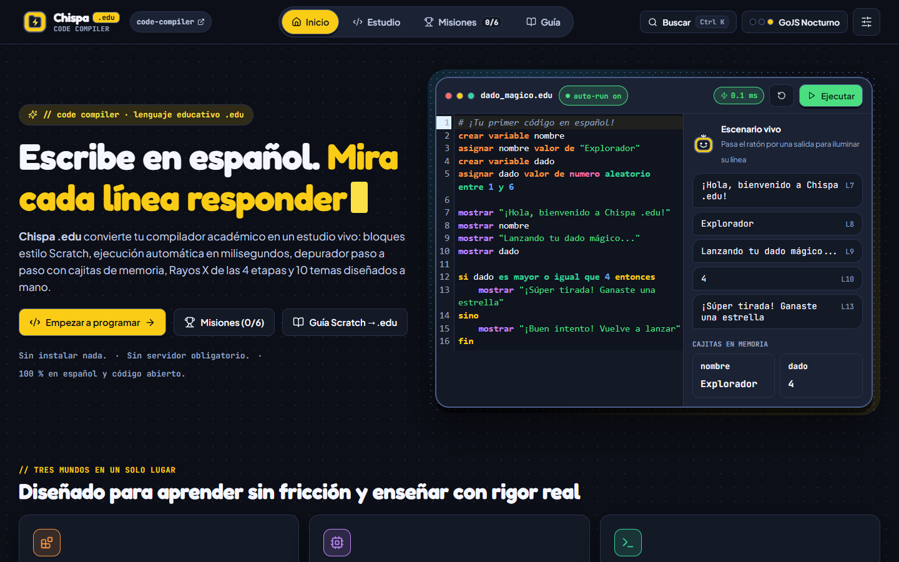
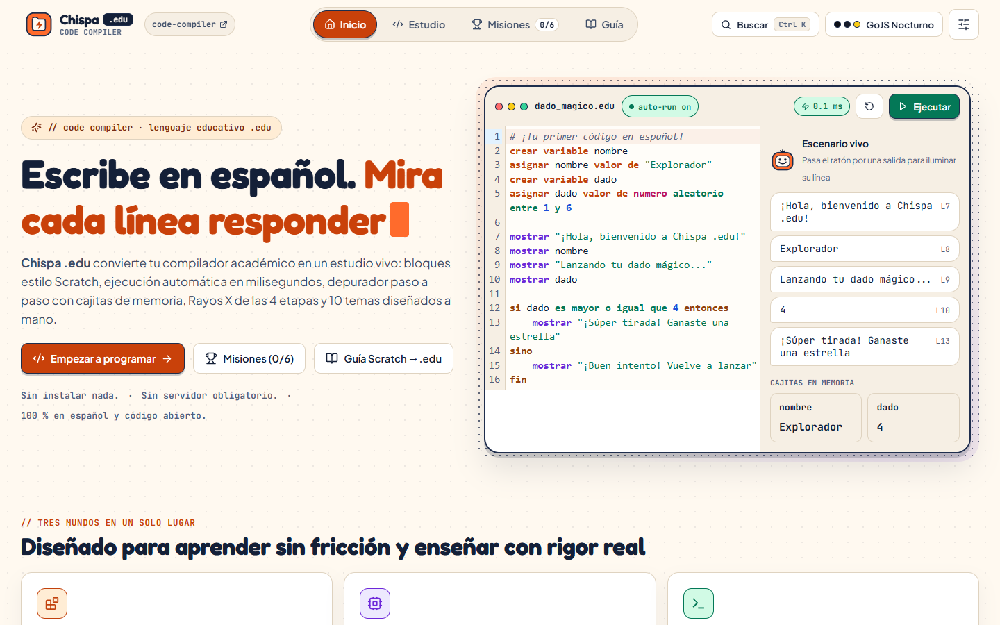
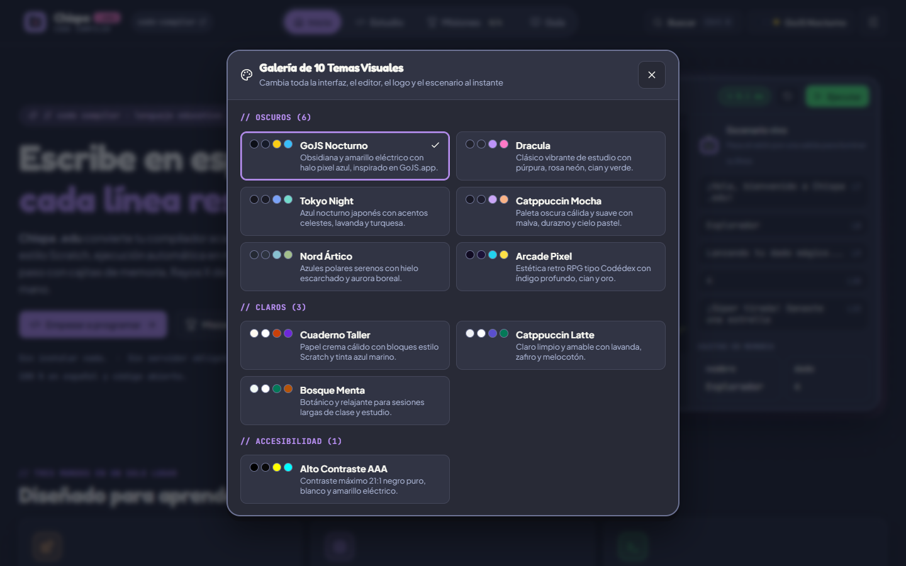
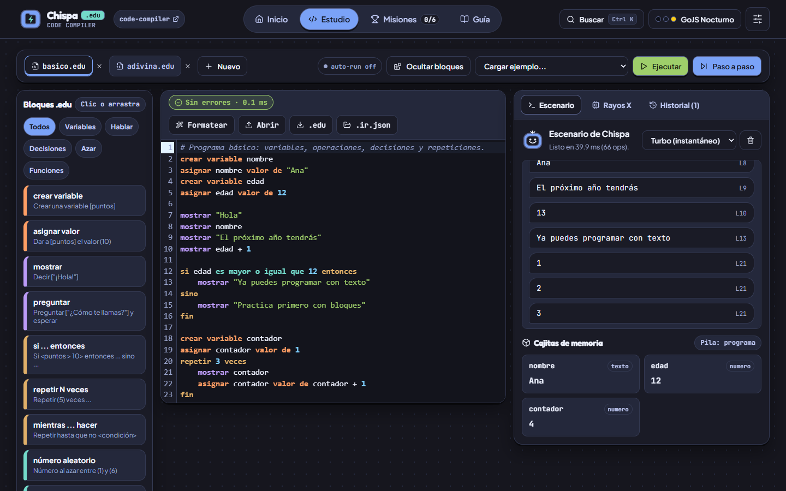
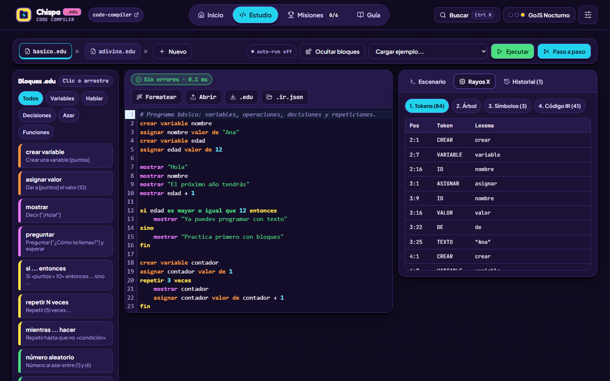
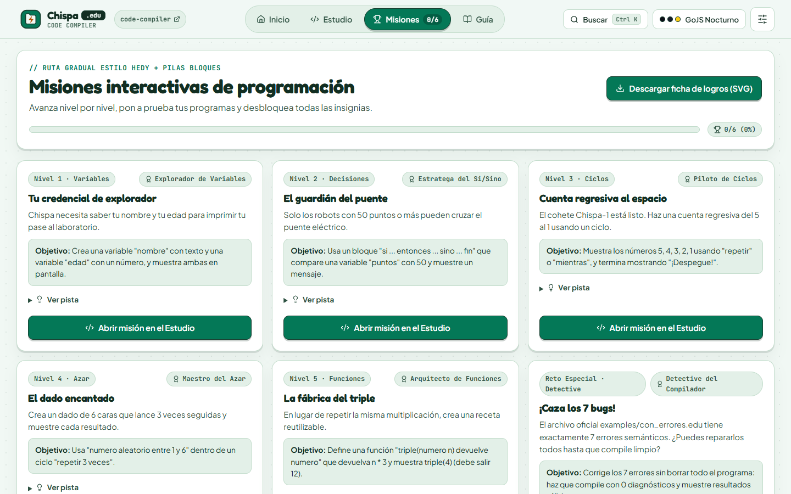
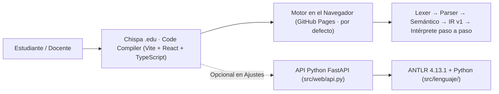

<p align="center">
  <picture>
    <source media="(prefers-color-scheme: dark)" srcset="docs/logo-dark.svg" />
    <source media="(prefers-color-scheme: light)" srcset="docs/logo-light.svg" />
    
  </picture>
</p>

<p align="center">
  <strong>Estudio web educativo, compilador e intérprete del lenguaje español <code>.edu</code> (<code>topional/code-compiler</code>), diseñado para facilitar la transición desde Scratch hacia la programación textual.</strong>
</p>

<p align="center">
  
  
  
  
  
</p>

---

## Capturas reales

| Portada en *GoJS Nocturno* (con halo pixel y auto-run) | Portada en *Cuaderno Taller* (claro estilo Scratch) |
| :---: | :---: |
|  |  |

| Galería visual de 10 temas (*Dracula*, *Tokyo Night*, *Arcade Pixel*...) | Estudio `.edu` en *Tokyo Night* con Bloques y Memoria |
| :---: | :---: |
|  |  |

| Rayos X del Compilador en *Arcade Pixel* | Misiones Guiadas en *Bosque Menta* |
| :---: | :---: |
|  |  |

---

## Qué incluye Chispa `.edu · Code Compiler`

| Módulo | Qué aporta al estudiante y al docente |
| :--- | :--- |
| **Portada interactiva tipo GoJS.app × Scratch** | Playground `dado_magico.edu` en vivo con halo pixel-matrix, `auto-run` editable, salidas clicables que iluminan su línea, puente interactivo Scratch ↔ `.edu`, visor de las 4 etapas del compilador y probador en vivo de los 10 temas. |
| **10 Temas Visuales artesanales** | **Oscuros:** *GoJS Nocturno*, *Dracula*, *Tokyo Night*, *Catppuccin Mocha*, *Nord Ártico*, *Arcade Pixel* · **Claros:** *Cuaderno Taller*, *Catppuccin Latte*, *Bosque Menta* · **Accesibilidad:** *Alto Contraste WCAG AAA 21:1*. Cambian toda la UI, sintaxis, logo SVG, mascota y scrollbar. |
| **Estudio `.edu` (IDE creativo)** | Editor CodeMirror 6 coloreado por categoría Scratch, `auto-run` inteligente (`800 ms`), **Formateador automático** (`Ctrl+Shift+F`), **Historial de instantáneas** con restauración en 1 clic, **Paleta de Comandos** (`Ctrl+K`), multipestaña persistente e importación/exportación `.edu` y `.ir.json`. |
| **Paleta de Bloques `.edu`** | Fichas táctiles (clic o drag & drop) organizadas por color Scratch que insertan código `.edu` válido al cursor. |
| **Escenario + Depurador Paso a Paso** | Burbujas interactivas (hover ilumina línea, clic salta a la línea), soporte real para `preguntar "..." guardar en x`, velocidad regulable (`Turbo / Normal / Lento`), **Cajitas de Memoria** animadas y **Pistas Pedagógicas** amigables junto a cada diagnóstico. |
| **Rayos X del Compilador** | Inspección en tiempo real de las 4 etapas: **1. Tokens (Lexer)** · **2. Árbol Sintáctico (Parser)** · **3. Tabla de Símbolos (Semántico)** · **4. Código Intermedio de 3 direcciones (JSON v1)**. |
| **Misiones Interactivas + Confeti** | 6 retos graduales (incluido *«¡Caza los 7 bugs!»* sobre `examples/con_errores.edu`) con verificación automática real, celebración con confeti (respetando movimiento reducido), insignias y ficha SVG descargable. |
| **Guía Visual Scratch ↔ `.edu`** | Diccionario buscable con tolerancia a errores tipográficos (**Fuse.js**) y botón *«Probar en el Estudio»*. |

---

## Arquitectura dual (100 % GitHub Pages + Backend Python intacto)



* **100 % estático para GitHub Pages:** El motor en `web/engine/` replica fielmente `grammar/EducativoLexer.g4`, `grammar/EducativoParser.g4`, `src/lenguaje/semantico.py`, `src/lenguaje/generador.py` y `src/lenguaje/interprete.py` (incluyendo aritmética exacta de fracciones y formato JSON v1), verificado contra toda la batería `tests/` y `examples/`.
* **Backend Python 100 % conservado:** Toda la cadena ANTLR4 + Python + FastAPI (`src/main.py`, `src/interprete.py`, `src/lenguaje/`, `src/web/`, `grammar/`, `tests/`) sigue intacta.

---

## Librerías open-source y referencias consultadas

| Librería / Recurso | Repositorio | Licencia | Uso en Chispa `.edu` |
| :--- | :--- | :--- | :--- |
| **React 19** | [facebook/react](https://github.com/facebook/react) | MIT | Interfaz declarativa y estado reactivo del Estudio. |
| **Vite 6** | [vitejs/vite](https://github.com/vitejs/vite) | MIT | Empaquetado estático optimizado para GitHub Pages. |
| **TypeScript 5** | [microsoft/TypeScript](https://github.com/microsoft/TypeScript) | Apache-2.0 | Tipado estricto del compilador, intérprete y UI. |
| **CodeMirror 6** | [codemirror/dev](https://github.com/codemirror/dev) | MIT | Editor accesible con sintaxis `.edu`, autocompletado y hover/línea activa. |
| **Motion** | [motiondivision/motion](https://github.com/motiondivision/motion) | MIT | Animaciones fluidas respetando `prefers-reduced-motion` (`MotionConfig`). |
| **Lenis** | [darkroomengineering/lenis](https://github.com/darkroomengineering/lenis) | MIT | Scroll suave con inercia (desactivado en movimiento reducido). |
| **Fuse.js** | [krisk/Fuse](https://github.com/krisk/Fuse) | Apache-2.0 | Búsqueda aproximada en la Guía Visual y Paleta `Ctrl+K`. |
| **canvas-confetti** | [catdad/canvas-confetti](https://github.com/catdad/canvas-confetti) | ISC | Celebración al completar misiones educativas. |
| **Lucide React** | [lucide-icons/lucide](https://github.com/lucide-icons/lucide) | ISC | Iconografía vectorial consistente. |
| **Fredoka / Plus Jakarta Sans / JetBrains Mono** | [fontsource/fontsource](https://github.com/fontsource/fontsource) | OFL-1.1 | Tipografías 100 % autoalojadas (cero CDNs externos). |
| **Vitest + Playwright + axe-core** | [vitest](https://github.com/vitest-dev/vitest) · [playwright](https://github.com/microsoft/playwright) · [axe-core](https://github.com/dequelabs/axe-core) | MIT / Apache-2.0 / MPL-2.0 | Pruebas de paridad, E2E y auditoría WCAG en los 10 temas y 4 viewports. |
| **ANTLR 4.13.1 + FastAPI** | [antlr/antlr4](https://github.com/antlr/antlr4) · [fastapi/fastapi](https://github.com/fastapi/fastapi) | BSD-3-Clause / MIT | Compilador CLI y API Python originales en `src/`. |
| **Referencias de diseño y pedagogía** | [midudev/gojs](https://github.com/midudev/gojs) · [fluyeporlaweb/awesome-design-stack](https://github.com/fluyeporlaweb/awesome-design-stack) · Scratch · Hedy · EduBlocks · Python Tutor · Codédex · Pilas Bloques | — | Inspiración para el playground instantáneo, la transición bloques→texto, el depurador visual y la galería de temas. |

---

## Instalación y ejecución local

### 1. Aplicación web (Chispa `.edu`)

Requisitos: **Node.js 20+** y **npm**.

```bash
npm install
npm run dev
```

### 2. Build de producción y vista previa local

```bash
npm run build
npm run preview
```

### 3. Compilador CLI y API Python originales (opcional)

```bash
python3 -m venv .venv
source .venv/bin/activate
python -m pip install -r requirements.txt
make generar
make probar ARCHIVO=examples/calculadora.edu
```

---

## Despliegue automático en GitHub Pages

El repositorio incluye [`.github/workflows/deploy-pages.yml`](.github/workflows/deploy-pages.yml):

1. Sube el proyecto a la rama `main` de tu repositorio en GitHub.
2. En **Settings → Pages → Build and deployment → Source**, elige **GitHub Actions**.
3. Cada `push` a `main` ejecuta `npm run typecheck && npm test && npm run build` y publica `dist/` automáticamente.

---

## Comandos de verificación

```bash
npm run typecheck   # Comprobación estricta TypeScript
npm test            # 13 suites de paridad contra tests/ y examples/
npm run build       # Build estático de producción
npm run audit:web   # Auditoría Playwright + axe-core (10 temas × 4 viewports × E2E)
```

---

## Documentación técnica original del compilador `.edu`

| Documento | Contenido |
| :--- | :--- |
| [docs/tokens.md](docs/tokens.md) | Especificación léxica (hito 1). |
| [docs/gramatica.md](docs/gramatica.md) | Gramática libre de contexto y evolución (hitos 1 y 2). |
| [docs/derivaciones.md](docs/derivaciones.md) | Derivaciones por la izquierda por construcción (hito 1). |
| [docs/semantica.md](docs/semantica.md) | Errores semánticos y tabla de símbolos (hitos 1 y 2). |
| [docs/arquitectura.md](docs/arquitectura.md) | Componentes, flujo de datos y decisión sin LLVM (hito 2). |
| [docs/intermedio.md](docs/intermedio.md) | Código intermedio de tres direcciones JSON v1 (hito 3). |
| [docs/plan_validacion.md](docs/plan_validacion.md) | Plan de validación por etapa (hito 2). |
| [docs/resultados_validacion.md](docs/resultados_validacion.md) | Resultados de validación (hito 3). |
| [docs/api.md](docs/api.md) | Contrato de la API web FastAPI + WebSocket. |
