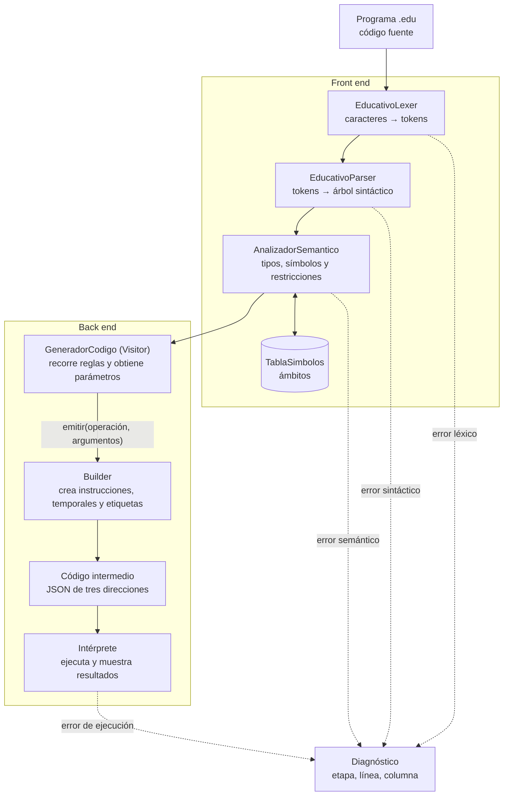

# Arquitectura del compilador

## Visión general

El compilador procesa un programa `.edu` en cuatro etapas. Cada etapa recibe el
resultado de la anterior y se detiene ante el primer grupo de errores, de modo
que ninguna etapa trabaja sobre una entrada inválida. El back end genera código
intermedio de tres direcciones, sin LLVM, que un intérprete propio ejecuta.



Las flechas continuas son el camino de un programa correcto. Las punteadas son
el camino de un error: la etapa que lo detecta produce un diagnóstico y el
programa no pasa a la siguiente. Hay tres puntos de entrada: `src/main.py`
compila desde la terminal, `src/interprete.py` ejecuta un JSON y
`src/web/api.py` atiende al editor web.

`src/lenguaje/compilador.py` encadena las cuatro etapas en la función
`compilar(codigo, etapa=...)`. La terminal y la API usan esa misma función, así
que producen el mismo resultado y los mismos diagnósticos.

## Componentes

| Componente | Archivo | Responsabilidad |
| --- | --- | --- |
| Gramática léxica | `grammar/EducativoLexer.g4` | Tokens: palabras reservadas sin distinguir mayúsculas, números, textos, identificadores, operadores, saltos de línea y comentarios. |
| Gramática sintáctica | `grammar/EducativoParser.g4` | Estructura del programa con reglas recursivas y alternativas vacías (`ε`). Reutiliza el vocabulario del lexer con `tokenVocab`. |
| Código generado | `src/generated/` | ANTLR 4.13.1 genera el lexer, el parser y el visitor base con `make generar`. No se edita a mano ni se versiona. |
| Compilador | `src/lenguaje/compilador.py` | Ejecuta las etapas en orden y reúne tokens, árbol, instrucciones y diagnósticos en un objeto `Compilacion`. |
| Tabla de símbolos | `src/lenguaje/tabla_simbolos.py` | Guarda por ámbito el nombre, la posición, el tipo, la inicialización y el valor numérico conocido de cada variable. |
| Analizador semántico | `src/lenguaje/semantico.py` | Visitor que infiere tipos, consulta la tabla y acumula los errores semánticos. |
| Generador de código | `src/lenguaje/generador.py` | Visitor que recorre el árbol validado y produce las instrucciones de tres direcciones. |
| Builder | `src/lenguaje/builder.py` | Crea cada `Instruccion` y administra temporales (`%tN`) y etiquetas (`%LN`). |
| Representación intermedia | `src/lenguaje/instruccion.py`, `src/lenguaje/intermedio.py` | Define la instrucción y la serializa, carga y valida como JSON de versión 1. |
| Intérprete | `src/lenguaje/interprete.py` | Ejecuta las instrucciones con ámbitos, llamadas recursivas, entrada y salida. |
| Diagnósticos | `src/lenguaje/diagnostico.py` | Representa un error con etapa, mensaje, línea y columna para la terminal y la API. |
| Driver de terminal | `src/main.py` | Lee el archivo, elige la última etapa (`--etapa`), muestra tokens y árbol (`--arbol`) y exporta el JSON (`--salida`). |
| Ejecutor de terminal | `src/interprete.py` | Carga un JSON exportado y lo ejecuta. |
| API web | `src/web/api.py`, `src/web/proceso_edu.py`, `src/web/supervisor_edu.py` | `POST /compilar` devuelve el JSON. El WebSocket `/ejecutar` lo ejecuta en un subproceso supervisado. |
| Pruebas | `scripts/probar_entradas.sh`, `scripts/verificar_derivaciones.py`, `tests/` | Comprueban cada etapa, las derivaciones, el intérprete y la API. |

## Flujo de datos

1. **Lectura.** `main.py` lee el archivo en UTF-8. Si no se puede leer, termina
   con código 2.
2. **Análisis léxico.** `EducativoLexer` produce los tokens. Un listener
   convierte cada error de ANTLR en un `Diagnostico` de la etapa `lexer`.
3. **Análisis sintáctico.** `EducativoParser.programa()` construye el árbol.
   Los errores se registran como diagnósticos de la etapa `gramatica`.
4. **Análisis semántico.** `AnalizadorSemantico` recorre el árbol. Cada
   expresión devuelve su tipo (`numero`, `texto`, `logico` o desconocido) y la
   tabla mantiene los ámbitos global, de función y de bloque.
5. **Generación de código intermedio.** `GeneradorCodigo` vuelve a recorrer el
   árbol y emite instrucciones como `asignar`, `+`, `saltar_si_falso`,
   `llamar` o `devolver`. Cada instrucción conserva la línea y la columna de
   origen. El contrato completo está en [intermedio.md](intermedio.md).
6. **Exportación.** Con `--etapa intermedio --salida programa.json`, el driver
   guarda las instrucciones como JSON de versión 1.
7. **Ejecución.** `src/interprete.py programa.json` valida el JSON y lo
   ejecuta. Las comprobaciones que dependen de valores conocidos solo al
   ejecutar, como los límites aleatorios o la cantidad de repeticiones, se
   hacen aquí.

El parámetro `--etapa lexer|gramatica|semantica|intermedio` detiene el flujo al
terminar esa etapa. Es la base de las pruebas automáticas por etapa.

## Ejemplo de principio a fin

El programa siguiente recorre todas las etapas. Las salidas son las reales del
compilador.

```text
crear variable total
asignar total valor de 2 + 3
mostrar total
```

**1. Lexer.** `python src/main.py ejemplo.edu --etapa lexer` produce 16 tokens.
Los de la segunda línea son:

```text
LÍNEA   COLUMNA   TOKEN           LEXEMA
2       1         ASIGNAR         'asignar'
2       9         ID              'total'
2       15        VALOR           'valor'
2       21        DE              'de'
2       24        NUMERO          '2'
2       26        SUMA            '+'
2       28        NUMERO          '3'
2       29        SALTO_LINEA     '\n'
```

**2. Parser.** Con `--arbol`, la asignación queda dentro de este subárbol. La
suma aparece en `suma → producto restoSuma`, que da prioridad a `*` y `/`:

```text
(asignacion asignar total valor de (expresion (disyuncion (conjuncion (negacion
  (comparacion (suma (producto (unaria (primaria 2)) restoProducto)
  (restoSuma + (producto (unaria (primaria 3)) restoProducto) restoSuma))
  comparacionOpt)) restoY) restoO)))
```

**3. Análisis semántico.** `total` se declara en el ámbito global. La primera
asignación le da el tipo `numero`, y `mostrar total` lee una variable ya
inicializada. Resultado: `Análisis semántico correcto.`

**4. Visitor y Builder.** `GeneradorCodigo.visitAsignacion` visita la
expresión. `visitSuma` obtiene los operandos `2` y `3` y llama a
`builder.operacion("+", "2", "3")`, que crea la instrucción y el temporal
`%t1`. Después, `visitAsignacion` llama a `builder.asignar("%v1_total", "%t1")`.
El Visitor decide qué generar y el Builder construye cada instrucción.

**5. Código intermedio.** `--etapa intermedio --salida ejemplo.json` guarda
cinco instrucciones de tres direcciones. Se omiten los campos vacíos:

| # | operacion | argumento1 | argumento2 | resultado | origen |
| --- | --- | --- | --- | --- | --- |
| 0 | `declarar` | | | `%v1_total` | 1:1 |
| 1 | `+` | `2` | `3` | `%t1` | 2:26 |
| 2 | `asignar` | `%t1` | | `%v1_total` | 2:1 |
| 3 | `leer` | `%v1_total` | | `%t2` | 3:9 |
| 4 | `mostrar` | `%t2` | | | 3:1 |

**6. Ejecución.** `python src/interprete.py ejemplo.json` imprime `5`.

## Trazabilidad de los componentes

| Componente | Archivos y funciones principales | Entrada | Salida | Pruebas |
| --- | --- | --- | --- | --- |
| Lexer | `grammar/EducativoLexer.g4` → `EducativoLexer` | Texto `.edu` | Tokens | `tests/lexer/` (11 entradas) |
| Parser | `grammar/EducativoParser.g4` → `EducativoParser.programa()` | Tokens | Árbol sintáctico | `tests/gramatica/` (15 entradas), `scripts/verificar_derivaciones.py` (68 derivaciones) |
| Analizador semántico | `src/lenguaje/semantico.py` → `AnalizadorSemantico.visit*` | Árbol | Tipos y diagnósticos | `tests/semantica/` (18 entradas) |
| Tabla de símbolos | `src/lenguaje/tabla_simbolos.py` → `declarar`, `buscar`, `abrir_ambito`, `cerrar_ambito` | Declaraciones y usos | Símbolos por ámbito | `tests/semantica/` (ámbitos, inicialización) |
| Visitor de generación | `src/lenguaje/generador.py` → `GeneradorCodigo.visit*` | Árbol validado | Llamadas al Builder | `tests/test_interprete.py`, `tests/test_programas.py` |
| Builder | `src/lenguaje/builder.py` → `emitir`, `temporal`, `nueva_etiqueta`, `operacion`, `asignar`… | Operación y operandos | Lista de `Instruccion` | `tests/test_interprete.py`, `tests/test_programas.py` |
| Código intermedio | `src/lenguaje/intermedio.py` → `serializar_intermedio`, `cargar_intermedio`, `validar_intermedio` | Instrucciones | JSON de versión 1 | `tests/test_interprete.py` (`test_json_invalido`) |
| Intérprete | `src/lenguaje/interprete.py` → `ejecutar` | JSON | Salida del programa | `tests/test_interprete.py`, `tests/test_programas.py` |
| Driver | `src/main.py` → `main`, `exportar_intermedio`; `src/lenguaje/compilador.py` → `compilar` | Archivo `.edu` | Tokens, árbol, JSON o diagnósticos | `scripts/probar_entradas.sh`, `tests/test_interprete.py` |
| API web | `src/web/api.py` → `POST /compilar`, WebSocket `/ejecutar` | Texto `.edu` | JSON y ejecución interactiva | `tests/test_api.py` |

## Formato de errores

Todos los diagnósticos usan el mismo formato:

```text
Error <etapa> en <línea>:<columna>: <mensaje>
```

`<etapa>` es `léxico`, `sintáctico`, `semántico` o `de generación`. La línea y la
columna empiezan en 1. Los mensajes semánticos están en español e incluyen una
sugerencia de corrección. Los léxicos y sintácticos conservan el detalle de
ANTLR, que puede aparecer en inglés. Los errores de ejecución también incluyen
la línea y la columna de la instrucción de origen.

| Código de salida | Significado |
| --- | --- |
| 0 | Todas las etapas solicitadas terminaron sin errores. |
| 1 | Error léxico, sintáctico, semántico, de generación o de ejecución. |
| 2 | El archivo no se pudo leer o los argumentos son inválidos. |

## Decisión: código intermedio sin LLVM

El enunciado permite generar código final con LLVM o código intermedio sin LLVM,
según la naturaleza del proyecto. El equipo eligió código intermedio de tres
direcciones con un intérprete propio por tres razones:

- El lenguaje es educativo y se ejecuta desde un editor web; un intérprete en
  Python funciona en el servidor sin compilar binarios nativos.
- `preguntar` necesita intercambiar entradas con el editor durante la
  ejecución, lo que el WebSocket `/ejecutar` resuelve directamente.
- Las instrucciones conservan la posición de origen, así que los errores de
  ejecución señalan la línea del programa del estudiante.
